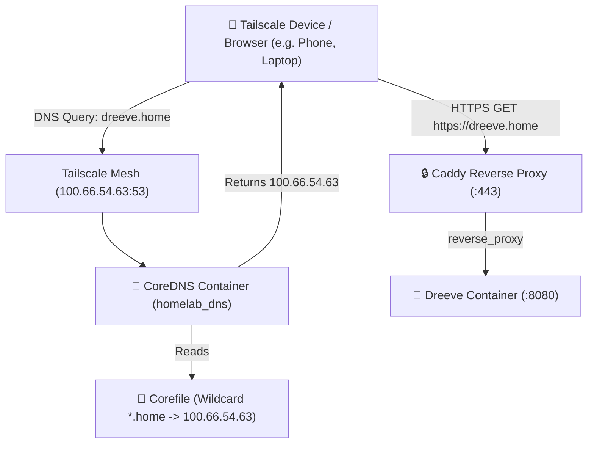

# Homelab DNS & Resilience Architecture 🌐

This directory contains the private DNS resolution infrastructure for the **`.home`** top-level domain across all homelab services and Tailscale devices.

---

## 🏛️ How `.home` Resolution Works



1. **DNS Lookup**: Any request to `*.home` (e.g. `dreeve.home`, `vault.home`, `immich.home`) is directed by Tailscale's split DNS to CoreDNS on `100.66.54.63:53`.
2. **Wildcard Routing**: CoreDNS immediately answers with the server's Tailscale IP (`100.66.54.63`).
3. **Reverse Proxy**: Caddy intercepts incoming HTTPS traffic on port 443, matches the domain header, terminates TLS, and proxies traffic to the target Docker container over the internal Docker network.

---

## ⚡ The Boot Race Condition & Permanent Fix

### The Problem
When the physical server reboots:
1. The **Docker daemon** initializes very early during system startup.
2. The **Tailscale daemon** (`tailscaled`) takes a few seconds longer to establish the wireguard mesh tunnel and acquire `100.66.54.63`.
3. Because `docker-compose.yml` binds `homelab_dns` explicitly to `"100.66.54.63:53"`, Docker attempts to bind the port before the IP address exists on the host.
4. Linux kernel by default rejects binding to non-existent IPs (`cannot assign requested address`), causing `homelab_dns` to fail with `Exited (255)`.

### The Permanent Multi-Layer Solution

We implemented automated resilience across multiple layers:

#### Layer 1: Dedicated Watchdog Script (`/opt/homelab/dns/ensure-dns.sh`)
* Polls `ip -4 addr show` until `100.66.54.63` is detected on `tailscale0`.
* Once the IP is active, automatically executes `docker start homelab_dns`.
* Continues in a lightweight 15-second loop as a health watchdog to revive the container if it ever stops.

#### Layer 2: Headless Boot Execution via Cron
* Added an `@reboot` entry in user crontab:
  ```bash
  @reboot /opt/homelab/dns/ensure-dns.sh >/dev/null 2>&1
  ```
* Guaranteed to trigger immediately upon system reboot even if no interactive user session has logged in yet.

#### Layer 3: Systemd User Service
* Configured and enabled at `~/.config/systemd/user/homelab-dns-watchdog.service`:
  ```bash
  systemctl --user status homelab-dns-watchdog.service
  ```

---

## 🔧 Optional: Kernel-Level Non-Local Binding

If you have `sudo` access and want to allow Docker to bind to Tailscale's IP before Tailscale finishes connecting, enable `ip_nonlocal_bind`:

```bash
# Apply immediately
sudo sysctl -w net.ipv4.ip_nonlocal_bind=1

# Persist across reboots
echo "net.ipv4.ip_nonlocal_bind=1" | sudo tee /etc/sysctl.d/99-homelab.conf
```

With `ip_nonlocal_bind = 1`, the Linux kernel permits binding to IP addresses that do not yet exist, allowing Docker to bind `100.66.54.63:53` instantly at boot.

---

## 📋 Service Domain Directory

All domains resolve via `homelab_dns` and proxy through Caddy:

| Service | Local Domain | Port | Description |
| :--- | :--- | :--- | :--- |
| **Dreeve** | `https://dreeve.home` | `8080` (or `:8081` direct) | Sports & Running Telemetry Dashboard |
| **Vaultwarden** | `https://vault.home` | `80` (or `:32768` direct) | Password Manager & Vault |
| **Immich** | `https://immich.home` | `2283` | Photos & Video Backup |
| **Portainer** | `https://portainer.home` | `9000` | Docker Management UI |
| **File Browser** | `https://files.home` | `80` (or `:8080` direct) | Personal Cloud Storage |
| **NoiseFit Bridge** | `https://noisefit.home` | `8085` | Watch Sync & Continuous HR Bridge |
| **Running Chatbot** | `http://localhost:8501` | `8501` | Dreeve Interactive Running Coach UI |

---

## 🛠️ Verification & Troubleshooting

Check DNS resolution:
```bash
dig @100.66.54.63 dreeve.home
```

Check Watchdog status:
```bash
systemctl --user status homelab-dns-watchdog.service
journalctl --user -u homelab-dns-watchdog.service -n 20 --no-pager
```

Manually restart DNS:
```bash
docker start homelab_dns
```
